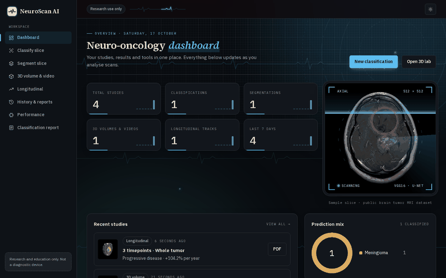
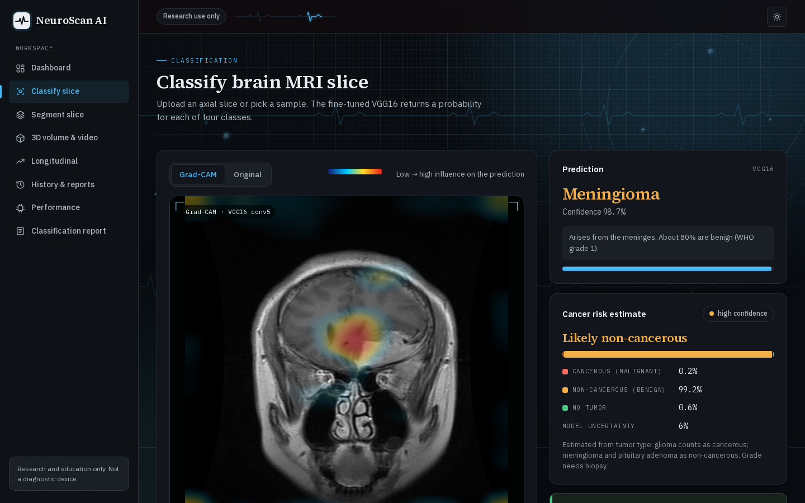
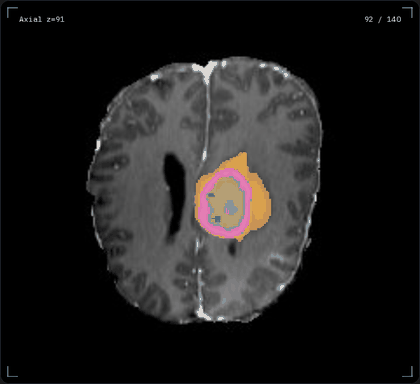
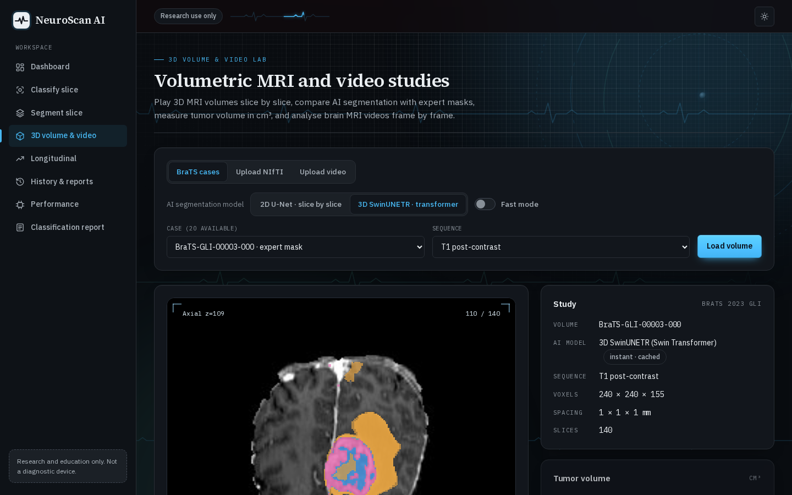
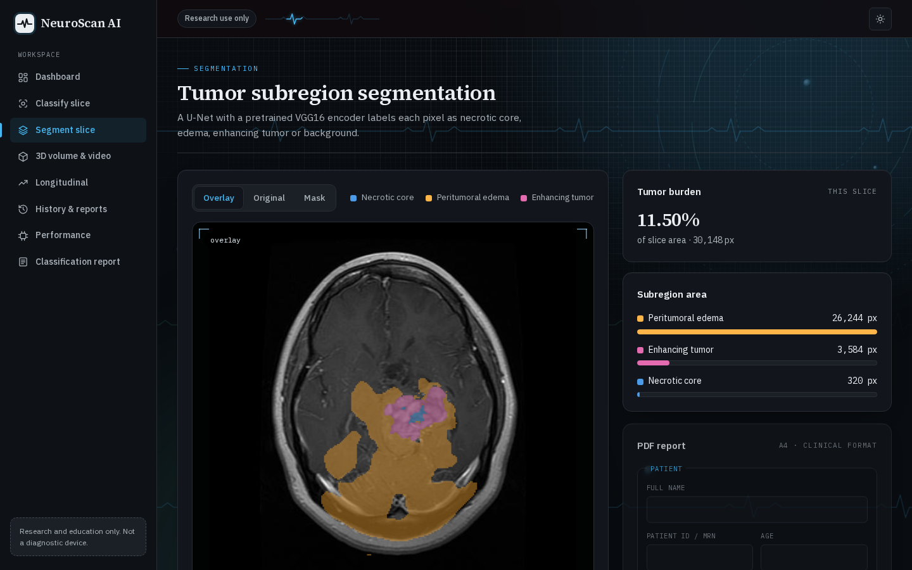
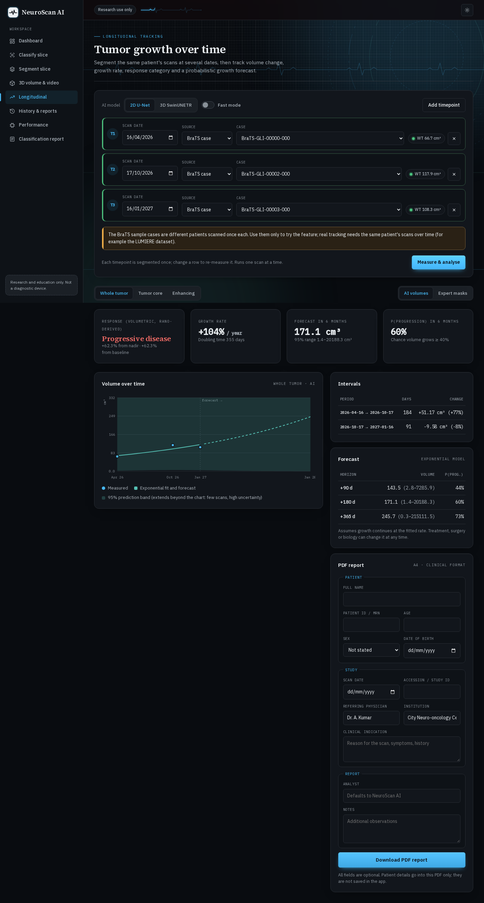
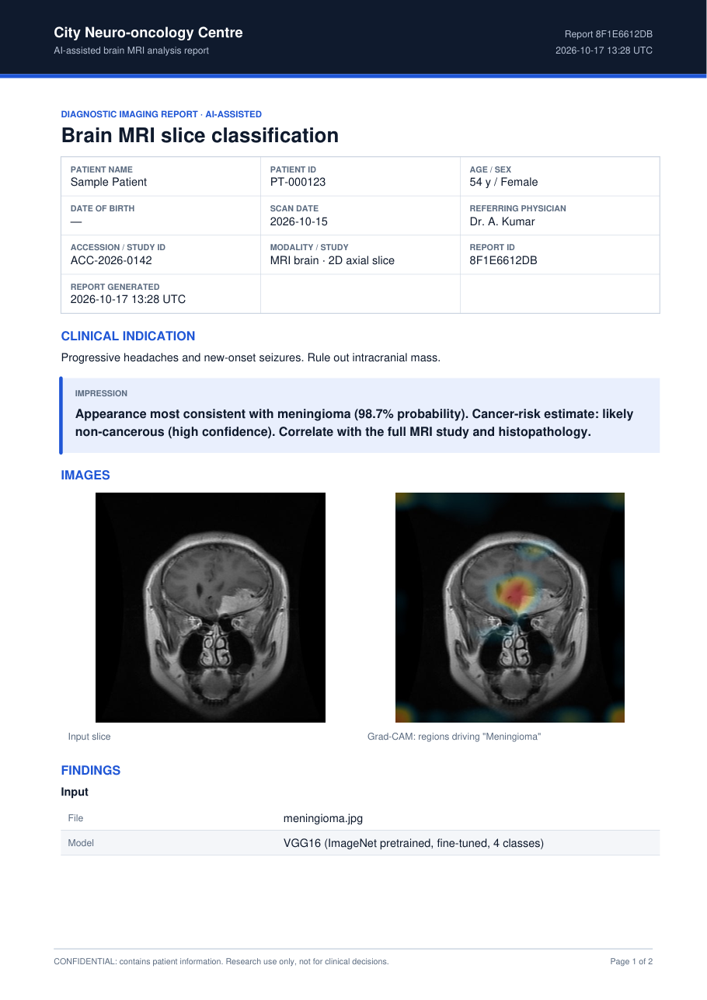
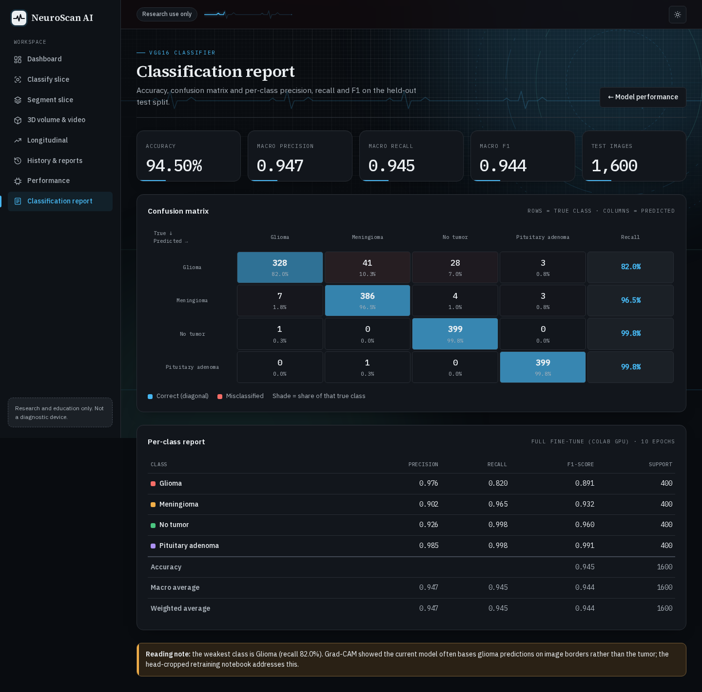
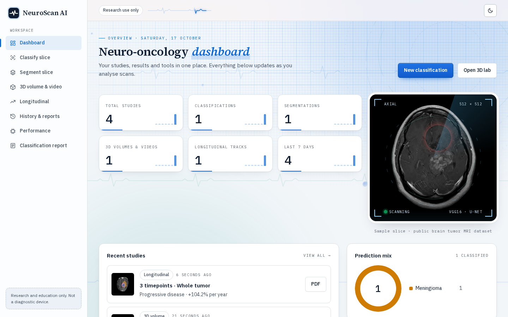
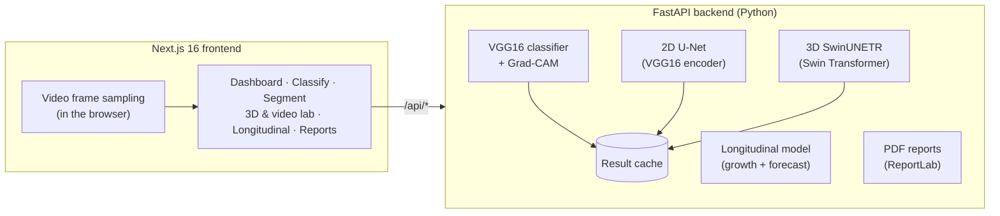

<div align="center">

# Longitudinal Brain Tumour Segmentation using 3D Vision Transformer and Pretrained Models

**NeuroScan AI**: a full-stack deep-learning workstation for brain-tumour MRI: tumour-type classification,
2D and 3D segmentation, video analysis, longitudinal growth forecasting and clinical-style PDF reports.




🎬 **[Watch the full walkthrough video (MP4)](docs/media/demo.mp4)**

</div>

> ⚠️ **Research and education only.** This is not a medical device and is not cleared for clinical use.
> AI output must be reviewed by a qualified clinician and must never be used to diagnose, treat or triage patients.

---

## Contents

- [Highlights](#highlights)
- [Results](#results)
- [Screenshots](#screenshots)
- [Architecture](#architecture)
- [Models](#models)
- [Datasets](#datasets)
- [Getting started](#getting-started)
- [Training (Google Colab)](#training-google-colab)
- [API](#api)
- [Project structure](#project-structure)
- [Limitations](#limitations)
- [Acknowledgements](#acknowledgements)

## Highlights

| | Feature | Details |
|---|---|---|
| 🧠 | **3D Vision Transformer segmentation** | MONAI **SwinUNETR** on whole MRI volumes (T1c + FLAIR), encoder initialised from self-supervised Swin-ViT weights |
| 🔬 | **Tumour-type classification** | **VGG16** (ImageNet-pretrained, fine-tuned): glioma, meningioma, pituitary adenoma, no tumour |
| ⚖️ | **Cancer-risk probability** | Cancerous vs non-cancerous estimate with confidence level and model uncertainty |
| 🔥 | **Explainability** | **Grad-CAM** heatmaps plus an automatic check of how much attention falls on head tissue |
| 🩻 | **2D segmentation** | **U-Net with a pretrained VGG16 encoder**: necrotic core, edema, enhancing tumour |
| 🎞️ | **3D & video lab** | Cine playback of volumes, expert vs AI masks, tumour volume in cm³; video frames get detection boxes + masks automatically |
| 📈 | **Longitudinal tracking** | Volume over time, growth rate, doubling time, RANO-derived response category, exponential forecast with 95% band and **P(progression)** |
| 📄 | **Clinical PDF reports** | Patient demographics, impression, images, findings, sign-off, page X of Y |
| ⚡ | **Fast inference on CPU** | channels-last kernels, optional fast mode (2–3× quicker), persistent result cache (repeat = instant) |
| 🎨 | **Medical-grade UI** | Dark reading-room and light clinical themes, animated ECG/scanner background, responsive |

## Results

All scores are on **held-out data the models never saw during training**.

### Tumour-type classification · VGG16

| Metric | Value |
|---|---|
| **Accuracy** | **94.5 %** (1,600 test images) |
| Macro F1 | 0.944 |

| Class | Precision | Recall | F1 |
|---|---|---|---|
| Glioma | 0.976 | 0.820 | 0.891 |
| Meningioma | 0.902 | 0.965 | 0.932 |
| No tumour | 0.926 | 0.998 | 0.960 |
| Pituitary adenoma | 0.985 | 0.998 | 0.991 |

### Tumour segmentation · Dice score

| Region | 2D U-Net (VGG16 encoder) | **3D SwinUNETR (Vision Transformer)** |
|---|---|---|
| Whole tumour | 0.800 | **0.885** |
| Tumour core | **0.875** | 0.808 |
| Enhancing tumour | 0.821 | **0.822** |
| Mean | 0.832 | **0.838** |
| Evaluated on | 1,193 slices | 24 patients (whole 3D volumes) |

The 3D transformer is clearly better on whole tumour, the region that matters most for volume tracking.
The two models were evaluated on different held-out patient splits and inputs (single 2D slices vs T1c + FLAIR volumes).

## Screenshots

<table>
  <tr>
    <td width="50%"><b>Classification + Grad-CAM + cancer-risk estimate</b><br></td>
    <td width="50%"><b>3D SwinUNETR segmentation (cine)</b><br></td>
  </tr>
  <tr>
    <td><b>3D volume & video lab</b><br></td>
    <td><b>Slice segmentation</b><br></td>
  </tr>
  <tr>
    <td><b>Longitudinal growth forecast</b><br></td>
    <td><b>Clinical PDF report</b><br></td>
  </tr>
  <tr>
    <td><b>Classification report & confusion matrix</b><br></td>
    <td><b>Light clinical theme</b><br></td>
  </tr>
</table>

Media are generated from the running app with [`tools/capture_media.py`](tools/capture_media.py).

## Architecture



| Layer | Stack |
|---|---|
| Frontend | Next.js 16 (App Router), React 19, TypeScript, modern CSS (OKLCH, container queries, `:has()`, scroll-driven animation) |
| Backend | FastAPI, PyTorch, torchvision, MONAI, nibabel, SciPy, ReportLab |
| Training | Google Colab / Kaggle GPU notebooks (resumable, checkpoints to Google Drive) |

## Models

| Model | Task | Pretraining | Input |
|---|---|---|---|
| **VGG16** | 4-class tumour type | ImageNet-1K, full fine-tune | 224 × 224 axial slice |
| **U-Net + VGG16 encoder** | 2D segmentation (NCR / ED / ET) | ImageNet-1K encoder | 256 × 256 slice |
| **SwinUNETR** | 3D segmentation (TC / WT / ET) | Self-supervised Swin-ViT (MONAI, 5,050 CT volumes) | T1c + FLAIR volume, 96³ patches |

**Cancer-risk estimate:** the classifier predicts tumour type; malignancy is derived from typical biology (glioma: cancerous;
meningioma and pituitary adenoma: non-cancerous). It is a type-based prior, not a histological grade.

**Longitudinal forecast:** exponential growth fitted by least squares on log-volume; with three or more scans a Student-t
prediction interval gives a 95% band and the probability of ≥ 40% volume growth (a volumetric progression threshold derived from RANO).

## Datasets

| Dataset | Used for | Licence |
|---|---|---|
| [BraTS 2023 Adult Glioma](https://huggingface.co/datasets/MedOtter/brats2023-gli-dataset) (ASNR-MICCAI) | 2D & 3D segmentation, 3D lab | CC BY 4.0 |
| [Brain Tumor MRI Dataset](https://huggingface.co/datasets/BJyotibrat/Masoud-Nickparvar-Brain-Tumor-MRI-Dataset) (M. Nickparvar) | Classification | CC BY 4.0 |

Datasets and trained weights are **not stored in this repository**. Scripts download the data; the notebooks produce the weights.

## Getting started

**Requirements:** Python 3.12+, Node.js 20+, ~8 GB RAM.

```bash
git clone https://github.com/Shriniketh59/longitudinal-brain-tumour-segmentation.git
cd longitudinal-brain-tumour-segmentation

# Backend
cd backend
pip install -r requirements.txt
python -m scripts.download_brats --cases 20      # sample 3D cases for the 3D lab
# put trained weights in backend/weights/ (see Training)
uvicorn app.main:app --port 8000

# Frontend (new terminal)
cd frontend
npm install
npm run dev                                      # http://localhost:3000
```

The frontend proxies `/api/*` to the backend, so everything runs on **http://localhost:3000**.

## Training (Google Colab)

| Notebook | Trains | Time on a free T4 |
|---|---|---|
| [`train_neuroscan_colab.ipynb`](notebooks/train_neuroscan_colab.ipynb) | VGG16 + 2D U-Net | ~30 min |
| [`train_vgg16_cropped.ipynb`](notebooks/train_vgg16_cropped.ipynb) | VGG16 on head-cropped slices (removes border shortcuts) | ~15 min |
| [`train_unet_only.ipynb`](notebooks/train_unet_only.ipynb) | 2D U-Net only, resumable | ~25 min |
| [`train_swin_unetr_3d.ipynb`](notebooks/train_swin_unetr_3d.ipynb) | **3D SwinUNETR**, resumable | ~40 min |

Upload a notebook to Colab → Runtime → T4 GPU → Run all. Weights and metrics download as a zip; unzip into `backend/weights/`.

## API

| Method | Endpoint | Purpose |
|---|---|---|
| `POST` | `/api/classify` | Tumour type, probabilities, cancer-risk estimate, Grad-CAM |
| `POST` | `/api/segment` | 2D segmentation of one slice |
| `POST` | `/api/video/analyze` | Detection boxes + masks + class for up to 16 frames |
| `GET` | `/api/volume/samples/{id}?model=unet2d\|swin3d&fast=` | 3D volume analysis (cached) |
| `POST` | `/api/volume/upload` | Uploaded NIfTI (+ FLAIR, expert mask) |
| `POST` | `/api/longitudinal/analyze` | Growth rate, response category, forecast |
| `POST` | `/api/report` | Clinical PDF report |
| `GET` | `/api/models/metrics` | Evaluation metrics of the loaded models |

## Project structure

```
backend/      FastAPI app, model code, training & data scripts, tests (pytest)
frontend/     Next.js app (pages, components, design system)
notebooks/    Colab / Kaggle training notebooks
deploy/       Hugging Face Space config + deploy script (see DEPLOY.md)
docs/media/   Screenshots, GIFs and demo video
tools/        Media capture script
```

## Limitations

- **Glioma shortcut.** Grad-CAM showed the current classifier often bases glioma predictions on image borders rather than the tumour (glioma recall 82%). [`train_vgg16_cropped.ipynb`](notebooks/train_vgg16_cropped.ipynb) retrains on head-cropped slices to remove this.
- **Segmentation domain.** Both segmenters were trained on skull-stripped BraTS gliomas; on other tumour types or scans with the skull, masks can be misplaced. Video detection therefore requires the classifier and the segmenter to agree.
- **Longitudinal data.** BraTS has one scan per patient, so the longitudinal demo uses different patients as stand-ins. Real tracking needs serial scans of the same patient (e.g. the LUMIERE dataset).
- **Not clinically validated.** No prospective evaluation, no regulatory clearance.

## Deployment

Frontend on **Vercel** (deploys from this GitHub repo), backend on a **Hugging Face Space** (Docker). See [DEPLOY.md](DEPLOY.md).

## Acknowledgements

- [MONAI](https://monai.io/) for SwinUNETR and the self-supervised Swin-ViT weights
- BraTS 2023 challenge organisers and data contributors (ASNR-MICCAI)
- Masoud Nickparvar for the Brain Tumor MRI dataset
- Hatamizadeh et al., *Swin UNETR: Swin Transformers for Semantic Segmentation of Brain Tumors in MRI Images* (2022)
- Simonyan & Zisserman, *Very Deep Convolutional Networks for Large-Scale Image Recognition* (2015)
- Ronneberger et al., *U-Net: Convolutional Networks for Biomedical Image Segmentation* (2015)

## Licence

Code: [MIT](LICENSE). Datasets keep their own licences (CC BY 4.0). Research and education use only.
